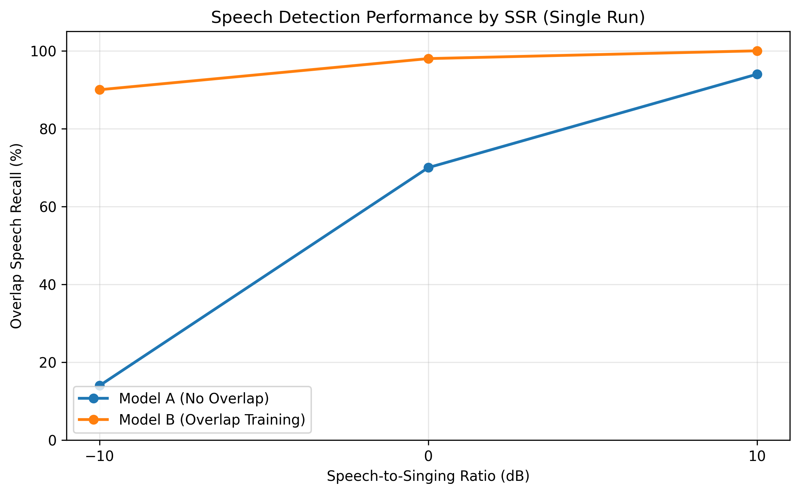

# Overlap-Aware Speech Detection

CNN-based spoken speech detection in overlapping singing voices.

## Overview

This project investigates whether training with overlapping
speech and singing improves spoken-speech detection under
challenging vocal mixtures.

Two CNN classifiers are compared:

- **Model A:** Trained on speech-only and singing-only recordings.
- **Model B:** Trained on the same underlying speech recordings,
  with a subset augmented using overlapping singing voices.

Both models use log-Mel spectrograms and identical CNN architectures.

## Motivation

This project was inspired by the paper
[Robust Speech Activity Detection in the Presence of Singing Voice](https://arxiv.org/abs/2512.09713)
(Grundhuber et al., WASPAA 2025).

The paper investigates the challenges of detecting spoken speech
in the presence of singing voices.

Building on this problem setting, I explored a specific question:

**Does training with overlapping speech–singing mixtures improve
spoken-speech detection compared with training on isolated voices?**

To investigate this, I implemented two CNN classifiers with identical
architectures and compared their performance across different
speech-to-singing ratios (SSRs).

This project is an independent experiment inspired by the paper,
rather than a reproduction of its methods.

## Methodology

- **Dataset:** GTSinger
- **Sample Rate:** 16 kHz
- **Clip Duration:** 2 seconds
- **Features:** 64-bin log-Mel spectrograms
- **Model:** Convolutional Neural Network (PyTorch)
- **SSR Conditions:** -10, 0, +10 dB
- **Training Samples:** 1,200 per model
- **Evaluation:** Singer-disjoint train, validation, and test splits
- **Threshold Selection:** Validation-based, with singing FPR constrained to 10%

## Experimental Results

Across three training seeds:

| Metric | Model A | Model B |
|---|---:|---:|
| Mean Overlap Recall | 47.1% | **95.6%** |
| Standard Deviation | 29.6 pp | **2.7 pp** |
| Singing False Positive Rate | 0% | 0% |

### Performance by Speech-to-Singing Ratio

Results from a single training run:

| SSR | Model A | Model B |
|---|---:|---:|
| -10 dB | 14% | **90%** |
| 0 dB | 70% | **98%** |
| +10 dB | 94% | **100%** |

The largest improvement occurred at -10 dB, where spoken
speech was quieter than singing.

## Limitations

- Evaluation uses synthetically mixed speech and singing,
  rather than real-world music recordings.
- Training, validation, and test data each contain one singer.
- Predictions are made at the 2-second clip level.

## Technologies

Python, PyTorch, Librosa, NumPy, Pandas, Matplotlib

## Dataset

[GTSinger](https://huggingface.co/datasets/GTSinger/GTSinger)
